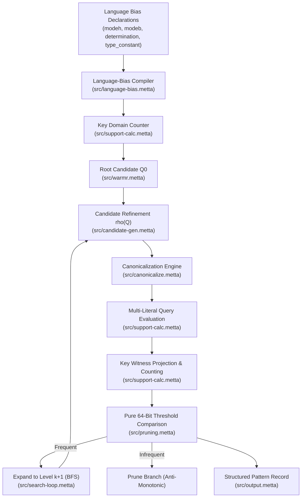

# WARMR: Independent Relational Pattern Miner in MeTTa/MM2 on MORK

[](#running-automated-tests)
[](#why-metta-mm2-and-mork)
[-orange)](#prerequisites)
[](LICENSE)

An independent, fully verified implementation of the **WARMR** (Dehaspe & Toivonen, 1999) frequent relational pattern mining algorithm, developed entirely in **MeTTa/MM2** and executed natively on **MORK** (Mork Operating Rule Kernel).

---

## Table of Contents

- [1. What is WARMR?](#1-what-is-warmr)
- [2. Why an Independent WARMR Implementation?](#2-why-an-independent-warmr-implementation)
- [3. Why MeTTa/MM2 and MORK?](#3-why-metta-mm2-and-mork)
- [4. System Architecture](#4-system-architecture)
- [5. Declarative Language Bias & Mode Declarations](#5-declarative-language-bias--mode-declarations)
- [6. Candidate Generation & Refinement](#6-candidate-generation--refinement)
- [7. Relational Support Calculation](#7-relational-support-calculation)
- [8. Distinct-Key Support & Multi-Proof Deduplication](#8-distinct-key-support--multi-proof-deduplication)
- [9. Canonicalization & Anti-Monotonic Pruning](#9-canonicalization--anti-monotonic-pruning)
- [10. Recursive Breadth-First Search (BFS)](#10-recursive-breadth-first-search-bfs)
- [11. Recursive Datalog Background Knowledge](#11-recursive-datalog-background-knowledge)
- [12. Supported Predicate Arities & Conjunction Depths](#12-supported-predicate-arities--conjunction-depths)
- [13. Prerequisites & Installation](#13-prerequisites--installation)
- [14. Running Automated Tests](#14-running-automated-tests)
- [15. Running Benchmarks via CLI](#15-running-benchmarks-via-cli)
- [16. Understanding Structured Output](#16-understanding-structured-output)
- [17. Known Limitations](#17-known-limitations)
- [18. Project Structure](#18-project-structure)

---

## 1. What is WARMR?

**WARMR** is a classic Inductive Logic Programming (ILP) algorithm that generalizes association rule mining (e.g. Apriori) from flat, single-table transactional databases to **multi-relational databases**. 

Instead of searching for sets of propositional items:
$$\{ \text{beer}, \text{diapers} \}$$
WARMR mines **First-Order Relational Horn Clauses**:
$$\text{positive\_example}(X) \leftarrow \text{parent}(X, Y) \wedge \text{parent}(Y, Z)$$
allowing variable sharing, multi-hop relational paths, arbitrary relation arities, and background knowledge.

---

## 2. Why an Independent WARMR Implementation?

The primary objective of this project is to develop an **independent, first-principles implementation** of WARMR to serve as an exact baseline for comparing against OpenCog Hyperon's pattern mining algorithms (specifically `iCog-Labs-Dev/Pattern-miner-mm2`).

By constructing this miner independently:
- We establish an algorithmic ground truth for relational candidate generation, canonicalization, support calculation, and pruning.
- We uncover the exact semantic differences between classical ILP distinct-key support and hypergraph subgraph matching.
- We validate the capabilities and runtime behavior of MeTTa/MM2 and MORK on computationally demanding relational search workloads.

---

## 3. Why MeTTa/MM2 and MORK?

- **MeTTa (Meta Type Talk):** A declarative, homoiconic knowledge representation language based on rewriting rules over an AtomSpace. It provides native support for pattern matching, first-order terms, and variable binding.
- **MM2:** The low-level execution dialect of MeTTa, optimized for compiled rule graphs.
- **MORK:** A high-performance execution engine implemented in Rust using a PathMap binary tree map (BTM). MORK provides deterministic priority-ordered execution, native 64-bit arithmetic, pure expression evaluation, and sub-millisecond execution speeds.

---

## 4. System Architecture

The miner is structured as a twelve-stage staged execution pipeline operating deterministically in MORK:



See [docs/architecture.md](docs/architecture.md) for full architecture details and MORK PathMap priority specifications.

---

## 5. Declarative Language Bias & Mode Declarations

WARMR constrains the hypothesis space using declarative mode declarations:

```metta
;; Head / Key predicate (X is the target key entity)
(modeh positive_example ((+ person)))

;; Body predicates with argument modes:
;;   + : Input slot (must bind to an existing variable in Q)
;;   - : Output slot (introduces a fresh existential variable)
;;   # : Constant slot (binds to an active constant from type_constant)
(modeb parent ((+ person) (- person)))
(modeb Inheritance ((+ person) (# attribute)))

;; Permitted predicate pairings
(determination positive_example parent)
(determination positive_example Inheritance)

;; Domain constant pool
(type_constant attribute man)
(type_constant attribute ugly)
(type_constant attribute sodaDrinker)
```

---

## 6. Candidate Generation & Refinement

Candidates are generated top-down via the refinement operator $\rho(Q)$, which specializes an active candidate by appending exactly one valid relational literal:

- **Level 0 ($Q_0$):** `(candidate root 0 () (((var 0) person)) nil)`
- **Level 1 ($\rho(Q_0)$):** Specializations directly rooted on key variable `(var 0)`:
  - Constant slot: `Inheritance(var 0, const man)`
  - Variable slot: `parent(var 0, var 1)`
  - Unary relation: `active(var 0)`
- **Level $k+1$ ($\rho(Q_k)$):** Adding connected literals to frequent Level $k$ queries (branching on existing variables or chaining to introduced output variables).

---

## 7. Relational Support Calculation

The support of a candidate query $Q = \text{key}(X) \leftarrow \text{Body}(X, \vec{Y})$ is defined as the number of distinct positive key entities $K$ for which there exists at least one substitution satisfying $\text{Body}(K, \vec{Y})$:

$$\text{supp}_{\mathcal{D}}(Q) = |\{ K \in \mathcal{K} \mid \mathcal{D} \models \exists \vec{Y} \text{Body}(K, \vec{Y}) \}|$$

The relative support is the exact rational fraction:
$$\text{rel\_supp}_{\mathcal{D}}(Q) = \frac{\text{supp}_{\mathcal{D}}(Q)}{|\mathcal{K}|}$$

---

## 8. Distinct-Key Support & Multi-Proof Deduplication

In multi-relational domains, a single key individual may satisfy a query through multiple distinct substitution proofs. 

For example, in the family dataset, `abel` has two children (`hana` and `bereket`):
- Proof 1: `parent(abel, hana) ∧ parent(hana, sami)`
- Proof 2: `parent(abel, hana) ∧ parent(hana, lidiya)`

Both proofs project onto the key variable `abel`:
$$\pi_X(\text{Proof}_1) = \text{abel}, \quad \pi_X(\text{Proof}_2) = \text{abel}$$

Using MORK's AtomSpace set semantics, each proof emits `(key_witness Q abel)`. Duplicate facts for `abel` collapse into exactly **one** witness atom, guaranteeing that `abel` contributes 1 to support.

---

## 9. Canonicalization & Anti-Monotonic Pruning

### Candidate Canonicalization
To prevent evaluating syntactically distinct but logically equivalent candidate permutations:
1. **Literal Sorting:** Body atoms are sorted lexicographically via MORK's pure `sort-atom` ($L_1 \wedge L_2 \equiv L_2 \wedge L_1$).
2. **Variable Normalization:** Variables are re-indexed from left to right sequentially starting at `(var 0)` via `vars_to_indices`.
3. **Pool Deduplication:** Normalized candidates inserted into `candidate_pool` collapse identical structures via PathMap set semantics.

### Anti-Monotonic Pruning
By the Anti-Monotonicity Theorem:
$$Q' \succeq_\theta Q \implies \text{supp}(Q') \le \text{supp}(Q)$$
If $\text{supp}(Q) < \text{MIN\_SUPPORT}$, then no specialization $Q' \in \rho(Q)$ can be frequent. The candidate is tagged with `(prune_branch Q)` and never receives an expansion token, safely eliminating entire unproductive subtrees.

---

## 10. Recursive Breadth-First Search (BFS)

The search loop proceeds level-by-level across increasing conjunction lengths:
1. **Level 1:** Evaluate 1-literal candidates. Classify frequent vs. infrequent.
2. **Level 2:** Expand frequent Level 1 candidates into 2-literal candidates. Classify and prune.
3. **Level 3:** Expand frequent Level 2 candidates into 3-literal candidates. Classify and prune.
4. **Termination:** Search terminates cleanly when `MAX_LENGTH` is reached or the candidate queue is empty.

---

## 11. Recursive Datalog Background Knowledge

The engine evaluates intensional recursive Datalog rules natively in MORK. For example, computing the transitive closure `ancestor/2` from base `parent/2` facts:

```metta
;; Base rule
(exec (warmr 050 base_ancestor)
  (, (parent $x $y))
  (O (+ (ancestor $x $y))))

;; Recursive rule
(exec (warmr 051 rec_ancestor)
  (, (parent $x $z) (ancestor $z $y))
  (O (+ (ancestor $x $y))))
```

Background rules execute at priority `warmr 050..052`, guaranteeing that derived relational facts are fully materialized into the AtomSpace before candidate evaluation begins at `warmr 312`.

---

## 12. Supported Predicate Arities & Conjunction Depths

| Arity | Predicate Shape | Example | Status |
|:---:|---|---|:---:|
| **1** | `P(+X)` | `active(user)` | Verified |
| **2** | `P(+X, -Y)`, `P(+X, #C)` | `parent(X, Y)`, `Inheritance(X, man)` | Verified |
| **3** | `P(+X, -Y, #C)` | `transfer(From, To, Bank)` | Verified |
| **4** | `P(+X, #C1, #C2, #C3)` | `audit_log(User, Svc, Action, Region)` | Verified |

- **Conjunction Depths:** Empirically verified up to **depth 5** (`step(A, B) ∧ step(B, C) ∧ step(C, D) ∧ step(D, E) ∧ step(E, F)`).
- **Threshold Range:** Pure 64-bit integer comparison (`gte_i64`), verified with thresholds from 0 to 1,000+.

---

## 13. Prerequisites & Installation

### Requirements
- Linux (x86_64)
- Bash 4.4+
- Native MORK binary (`mork`)

### MORK Setup
Ensure `mork` is compiled and accessible in your `PATH` or at `/home/hope/.local/bin/mork`:
```bash
# Verify MORK installation
mork --help
```

---

## 14. Running Automated Tests

Run the complete regression and generalization test suite:

```bash
./scripts/run-tests.sh
```

### Expected Output
```text
================================================================================
WARMR MORK Test Suite Runner
================================================================================
Workspace:   /home/hope/Projects/warmr-experiment
MORK Binary: /home/hope/.local/bin/mork
Suites:      19
--------------------------------------------------------------------------------
  PASS: tests/bias-test.metta            (15/15 assertions) [ 45 ms]
  PASS: tests/candidate-test.metta       (17/17 assertions) [ 50 ms]
  PASS: tests/canonicalize-test.metta    ( 7/ 7 assertions) [ 45 ms]
  PASS: tests/deep-search-test.metta     (19/19 assertions) [ 46 ms]
  PASS: tests/empty-domain-test.metta    ( 3/ 3 assertions) [ 46 ms]
  PASS: tests/empty-level-test.metta     ( 8/ 8 assertions) [ 45 ms]
  PASS: tests/family-test.metta          (12/12 assertions) [ 50 ms]
  PASS: tests/generalized-numeric-test.metta ( 8/ 8 assertions) [ 55 ms]
  PASS: tests/higher-arity-test.metta    (14/14 assertions) [ 47 ms]
  PASS: tests/integration-test.metta     (28/28 assertions) [ 61 ms]
  PASS: tests/max-length-test.metta      ( 5/ 5 assertions) [ 53 ms]
  PASS: tests/mm2-benchmark-test.metta   (29/29 assertions) [ 57 ms]
  PASS: tests/poc-support-test.metta     ( 2/ 2 assertions) [ 55 ms]
  PASS: tests/pruning-test.metta         (23/23 assertions) [ 64 ms]
  PASS: tests/recursive-datalog-test.metta (18/18 assertions) [ 82 ms]
  PASS: tests/support-test.metta         (13/13 assertions) [ 46 ms]
  PASS: tests/synthetic-test.metta       (15/15 assertions) [ 47 ms]
  PASS: tests/ternary-test.metta         (17/17 assertions) [ 48 ms]
  PASS: tests/unary-test.metta           (17/17 assertions) [ 45 ms]
--------------------------------------------------------------------------------
Test Execution Summary:
  Suites:     19 / 19 passed
  Assertions: 270 / 270 passed
Status:     ALL TESTS PASSED (100%)
================================================================================
```

To run an individual test suite:
```bash
./scripts/run-tests.sh tests/unary-test.metta
```

---

## 15. Running Benchmarks via CLI

The CLI tool `scripts/run-warmr.sh` provides a unified interface for executing relational pattern mining:

### Shared MM2 Benchmark (ugly-sodaDrinker)
```bash
./scripts/run-warmr.sh \
  --dataset benchmarks/ugly-sodaDrinker.metta \
  --keys benchmarks/ugly-sodaDrinker-keys.metta \
  --bias config/mm2-bias.metta \
  --min-support 2 \
  --max-length 3
```

### Unary Properties Benchmark
```bash
./scripts/run-warmr.sh \
  --dataset benchmarks/unary-properties.metta \
  --keys benchmarks/unary-properties-keys.metta \
  --bias config/unary-bias.metta \
  --min-support 5 \
  --max-length 2
```

### Recursive Family Datalog Benchmark
```bash
./scripts/run-warmr.sh \
  --dataset benchmarks/recursive-family.metta \
  --keys benchmarks/family-keys.metta \
  --bias config/family-bias.metta \
  --min-support 2 \
  --max-length 2
```

---

## 16. Understanding Structured Output

Frequent patterns are emitted in standardized, machine-readable S-expressions:

```metta
(warmr_pattern
  (id (cand_l2 man ugly))
  (length 2)
  (body ((Inheritance (var 0) (const man)) (Inheritance (var 0) (const ugly))))
  (absolute_support 5)
  (relative_support 5 20)
  (classification frequent)
  (dataset ugly-sodaDrinker)
  (min_support 2))
```

- `id`: Unique candidate identifier.
- `length`: Number of body literals.
- `body`: Canonicalized conjunction of relational literals.
- `absolute_support`: Exact number of matching key entities ($|\text{witnesses}|$).
- `relative_support`: Rational relative support ($5/20 = 25\%$).
- `classification`: `frequent` (support $\ge$ `min_support`).

---

## 17. Known Limitations

- **Verified Conjunction Depth:** Tested and verified up to depth 5. Combinatorial expansion bounds practical search beyond length 5.
- **Relational Arities:** Built-in template support covers arities 1, 2, 3, and 4. Arities $\ge 5$ require adding corresponding mode extraction rules.
- **Syntactic vs. Semantic Equivalence:** Uses structural sorting (`sort-atom`) and variable indexing (`vars_to_indices`). Full semantic $\theta$-subsumption is NP-complete and not implemented.
- **Monotonicity:** Designed for positive definite Horn queries and monotonic Datalog; non-monotonic negation and aggregation are excluded by language bias.

See [docs/limitations.md](docs/limitations.md) for detailed boundaries.

---

## 18. Project Structure

```text
warmr-experiment/
├── benchmarks/              # Relational benchmark datasets and key adapters
│   ├── ugly-sodaDrinker.metta     # Shared MM2 benchmark (SHA256: 3b8b322...)
│   ├── unary-properties.metta     # Unary property dataset (N=10)
│   ├── ternary-transactions.metta # Ternary banking transactions (N=6)
│   ├── events-4ary.metta          # 4-ary security audit events (N=5)
│   ├── deep-chain.metta           # 5-hop relational chain (N=6)
│   ├── recursive-family.metta     # Transitive closure Datalog dataset (N=7)
│   └── synthetic-genes.metta      # Gene regulation pathways (N=3)
├── config/                  # Language-bias mode declarations
│   ├── mm2-bias.metta             # Mode declarations for ugly-sodaDrinker
│   ├── unary-bias.metta           # Bias for unary properties
│   ├── ternary-bias.metta         # Bias for ternary transactions
│   ├── events-4ary-bias.metta     # Bias for 4-ary audit events
│   ├── deep-chain-bias.metta      # Bias for deep chains
│   └── family-bias.metta          # Bias for family relationships
├── docs/                    # In-depth architectural & algorithmic documentation
│   ├── architecture.md            # Staged execution pipeline and priority design
│   ├── algorithm.md               # WARMR theory, math, and ILP proofs
│   ├── benchmarks.md              # Detailed benchmark specifications & ground truth
│   └── limitations.md             # System boundaries and verified limits
├── reports/                 # Milestone audit reports
│   └── milestone-8-final-report.md# Final completion audit report
├── scripts/                 # CLI runners
│   ├── run-warmr.sh               # Command-line miner runner
│   └── run-tests.sh               # Automated test suite runner
├── src/                     # Core WARMR engine implementation in MeTTa/MM2
│   ├── data-model.metta           # Core data model and witness representations
│   ├── language-bias.metta        # Mode compiler and determination checker
│   ├── candidate-gen.metta        # Candidate validation and refinement operator
│   ├── canonicalize.metta         # Atom sorting and variable index normalization
│   ├── support-calc.metta         # Multi-literal query evaluation and counting
│   ├── pruning.metta              # 64-bit arithmetic and anti-monotonic pruning
│   ├── search-loop.metta          # Level-wise BFS driver
│   ├── warmr.metta                # Top-level pipeline coordinator
│   └── output.metta               # Standardized pattern record formatter
├── tests/                   # 19 automated test suites (270 assertions)
└── README.md                # Project documentation
```

---

## 19. License

This project is licensed under the MIT License - see the [LICENSE](LICENSE) file for details.
