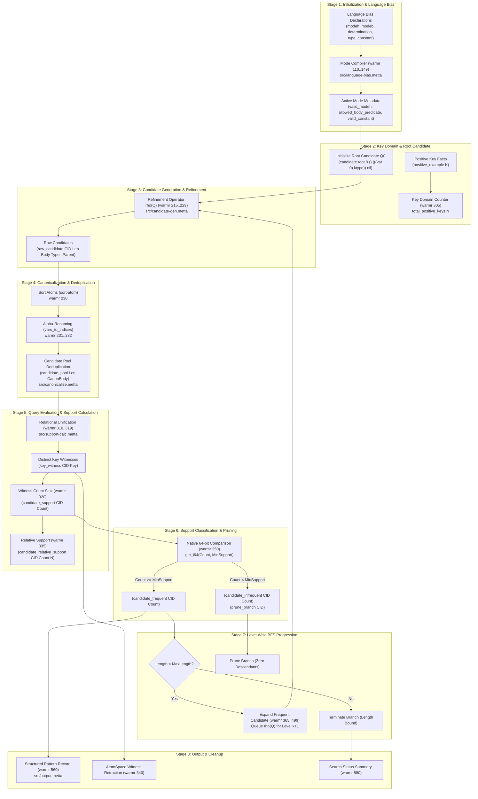

# System Architecture: Independent WARMR Miner in MeTTa/MM2 on MORK

## 1. Overview

The independent WARMR relational pattern miner is implemented entirely in **MeTTa/MM2** and executed natively on **MORK** (Mork Operating Rule Kernel). It implements top-down Breadth-First Search (BFS) over first-order relational conjunctions governed by declarative language-bias mode declarations.

---

## 2. End-to-End Pipeline Architecture

The execution lifecycle consists of twelve sequential stages orchestrated via MORK's deterministic priority-tagged PathMap binary tree map:

---

## 3. Priority Tag Conventions

MORK evaluates rewrite rules in ascending PathMap order. To guarantee strict determinism, all rules are registered within the `(exec (warmr <stage> <label>) <sources> <sinks>)` priority namespace:

| Priority Range | Component | Source File | Responsibilities |
|---|---|---|---|
| `warmr 050..052` | Recursive Datalog Engine | `benchmarks/recursive-family.metta` | Intensional deductive rules (`ancestor/2` transitive closure). |
| `warmr 110..149` | Language-Bias Compiler | `src/language-bias.metta` | Compiles `modeh`, `modeb`, `determination`, slot types, and thresholds. |
| `warmr 150..199` | Pipeline Coordinator | `src/warmr.metta` | Triggers key domain counting and root candidate Q0 initialization. |
| `warmr 201..229` | Candidate Generation & Refinement | `src/candidate-gen.metta` | Declarative validation and refinement $\rho(Q)$ across arities 1–4. |
| `warmr 230..249` | Canonicalization Engine | `src/canonicalize.metta` | Atom sorting (`sort-atom`) and variable indexing (`vars_to_indices`). |
| `warmr 305..309` | Domain Size Accounting | `src/support-calc.metta` | Counts total positive key individuals or sets empty fallback. |
| `warmr 310..319` | Query Matching | `src/support-calc.metta` | Unifies candidate body literals against database facts; emits witnesses. |
| `warmr 320..329` | Witness Counting | `src/support-calc.metta` | Projects distinct witnesses and aggregates count via MORK `count` sink. |
| `warmr 330..339` | Fallback & Ratios | `src/support-calc.metta` | Zero-support fallback and exact rational relative support emission. |
| `warmr 340..349` | State Cleanup | `src/support-calc.metta` | Retracts temporary `key_witness` atoms, leaving 0 memory leaks. |
| `warmr 350..364` | Native 64-Bit Classification | `src/pruning.metta` | Evaluates `gte_i64` on candidate support; emits frequent/infrequent atoms. |
| `warmr 365..399` | Level 1 Expansion Gate | `src/search-loop.metta` | Emits expansion tokens for frequent Level 1 candidates. |
| `warmr 400..449` | Level 2 BFS Pipeline | `src/search-loop.metta` | Level 2 refinement, conjunction evaluation, counting, and pruning. |
| `warmr 465..499` | Level 2 Expansion Gate | `src/search-loop.metta` | Emits expansion tokens for frequent Level 2 candidates. |
| `warmr 500..549` | Level 3 BFS Pipeline | `src/search-loop.metta` | Level 3 refinement, conjunction evaluation, counting, and pruning. |
| `warmr 560..569` | Output Formatter | `src/output.metta` | Emits standardized `(warmr_pattern ...)` records for frequent patterns. |
| `warmr 570..599` | Audit & Termination | `src/pruning.metta`, `src/search-loop.metta` | Pruning confirmation markers and clean search termination status. |

---

## 4. Key Architectural Subsystems

### 4.1. Language-Bias Mode Compiler (`src/language-bias.metta`)
Translates declarative bias specifications into executable constraints:
- **Head Modes (`modeh`):** Designates target key predicate and input variable type (e.g., `(modeh positive_example ((+ person)))`).
- **Body Modes (`modeb`):** Specifies allowed relation functors and argument slot roles:
  - `+` (Input slot): Must bind to an existing variable in the prefix query of matching type.
  - `-` (Output slot): Introduces a fresh existential variable of declared type.
  - `#` (Constant slot): Binds to an active constant from `type_constant`.
- **Determinations (`determination`):** Whitelists which body predicates may specialize a key predicate.

### 4.2. Candidate Generation & Canonicalization (`src/candidate-gen.metta`, `src/canonicalize.metta`)
- **Refinement Operator $\rho(Q)$:** Extends candidate query $Q$ by appending one valid literal satisfying connectivity and mode constraints.
- **Structural Normalization:** Eliminates syntactic redundancies:
  1. Conjunction commutativity: $L_1 \wedge L_2 \equiv L_2 \wedge L_1$ via `sort-atom`.
  2. Alpha-equivalence: Variable renaming via sequential indexing (`vars_to_indices`).
  3. Set deduplication: Insertion into `candidate_pool` collapses duplicates via PathMap set semantics.

### 4.3. Support Calculation & Multi-Proof Deduplication (`src/support-calc.metta`)
- In relational databases, a candidate query may match a single key entity through multiple substitution paths (e.g., a person having multiple children).
- **WARMR Key Projection Semantics:** Support is defined as the number of distinct positive key entities $K$ such that $\exists \vec{Y} \text{Body}(K, \vec{Y})$.
- **AtomSpace Set Semantics:** Each matching proof emits `(key_witness <cid> <key>)`. Duplicate proofs for the same key individual collapse into a single atom, guaranteeing exact distinct-key counting.

### 4.4. Native 64-Bit Arithmetic & Anti-Monotonic Pruning (`src/pruning.metta`)
- Threshold comparison uses pure MORK 64-bit integer instructions (`i64_from_string` + `gte_i64` + `i8_to_string`), supporting arbitrary non-negative support counts (0, 10, 500, 1000+).
- Infrequent candidates (`count < min_support`) are tagged with `prune_branch <cid>` and never receive expansion tokens, pruning entire subtrees of search space.

### 4.5. Recursive Datalog Engine
- Evaluates intensional Horn clauses directly within the AtomSpace prior to candidate matching.
- Deduplication of recursive proofs prevents infinite loops and combinatorial explosion.
