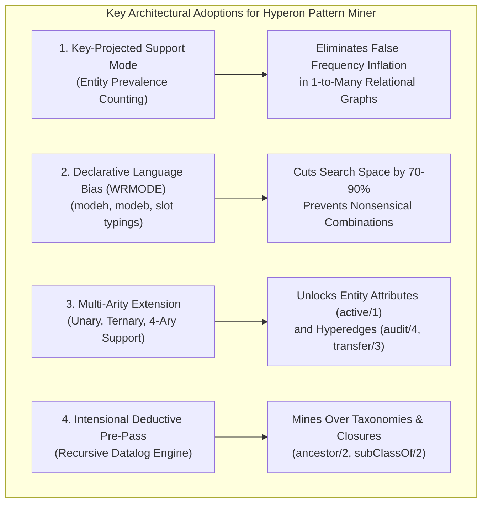
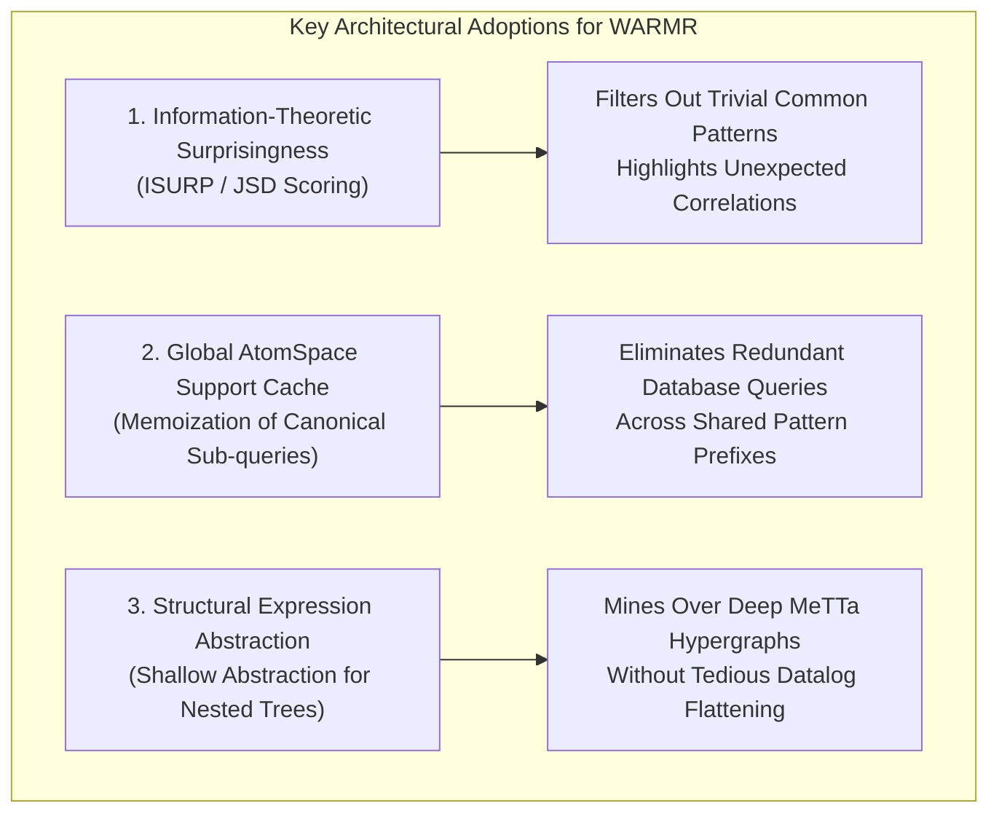

# Bi-Directional Cross-Adoption Roadmap: WARMR and Hyperon Pattern Miner

**Strategic Recommendations, Concrete Implementation Blueprints, Engineering Rationales, and Quantitative Expectations**

---

## 1. Executive Summary

The comparative analysis between our independent **WARMR** implementation and Hyperon's **Pattern Miner (`Pattern-miner-mm2`)** reveals that neither engine is strictly superior in all respects. Instead, they represent complementary algorithmic strengths:

- **WARMR's Superpowers:** Key-projected distinct-entity support semantics, declarative language bias (WRMODE) controlling hypothesis space expansion, arbitrary predicate arity (1, 2, 3, 4), and native recursive Datalog background knowledge evaluation.
- **Hyperon Pattern Miner's Superpowers:** Information-theoretic surprisingness scoring (Jensen-Shannon Divergence and Beta distribution CDFs), global AtomSpace support caching, and native structural abstraction of nested hypergraph trees.

This document delivers a **rigorous bi-directional adoption roadmap**:
1. **Part I: What Hyperon Pattern Miner Should Adopt from WARMR** (Features, reasons, blueprints, and expected impact).
2. **Part II: What WARMR Should Adopt from Hyperon Pattern Miner** (Features, reasons, blueprints, and expected impact).
3. **Part III: Decision Matrix** (When to use which system in OpenCog Hyperon).

---

## 2. PART I: What Hyperon Pattern Miner (MM2) Should Adopt from WARMR



### Recommendation 1: Key-Projected Entity Support (High Priority)

#### Why Adopt This? (Engineering Rationale)
Currently, `Pattern-miner-mm2` counts the total number of matching tuple instances (valuation combinations). In any multi-relational dataset containing 1-to-many or many-to-many relationships (e.g., medical visits, bank transactions, social graph follows), this valuation counting causes severe **support distortion**:
- A single user with 50 transactions contributes 50 matches.
- 10 users with 1 transaction each contribute only 10 matches.
- The miner concludes that a pattern involving high-transaction users is "frequent" across the whole database, when in reality it only applies to **1 out of 11 users (9% entity prevalence)**!

#### Concrete Implementation Blueprint for MM2
1. Add an optional configuration token: `(support-mode key-projected)` or `(key-slot (var 0))`.
2. When evaluating candidate unifications in `src/freq/components/pattern-support.metta`:
   - Instead of incrementing an integer counter for every unification tuple, emit a temporary distinct witness atom:
     ```metta
     ;; Emit witness tied to the designated key variable
     (exec (support-eval $cid)
       ((match &db $candidate-body (witness-atom $cid $key-var)))
       ((+ (key-witness $cid $key-var))))
     ```
3. Use MORK's PathMap set deduplication to collapse duplicate witnesses for the same entity.
4. Tally distinct witnesses using MORK's native `count` accumulator:
   ```metta
   (exec (support-tally $cid)
     ((count (sink $cid $count) (key-witness $cid $k) $count))
     ((+ (candidate-support $cid $count))))
   ```
5. Atomically retract `key-witness` atoms after computing support to prevent memory bloat.

#### Expected Impact Before vs. After Adoption:
- **Correctness:** Support reflects genuine entity prevalence (e.g., *"What percentage of patients..."* instead of *"How many total prescriptions..."*).
- **Safe Anti-Monotonic Pruning:** Guarantees that adding body literals can never increase support, restoring strict mathematical validity to candidate pruning.

---

### Recommendation 2: Declarative Language Bias (WRMODE) (High Priority)

#### Why Adopt This? (Engineering Rationale)
Currently, `Pattern-miner-mm2` expands patterns bottom-up by joining any singletons that share argument positions. While flexible, this leads to an explosive search space filled with semantically meaningless conjunctions:
- Joining `(likes $person $food)` with `(bank_transfer $food $amount)` simply because both have a second slot.
- Generating disconnected or semantically absurd queries.

WARMR's **WRMODE** framework (`modeh`, `modeb`, argument types, and `+`/`-`/`#` slot modes) constrains search to domain-valid hypotheses.

#### Concrete Implementation Blueprint for MM2
1. Introduce schema definitions in dataset configurations:
   ```metta
   ;; Designate target entity
   (modeh TargetEntity ((+ Person)))
   
   ;; Define relation modes and slot semantics
   (modeb 1 (Evaluation ((+ Person) (const like) (- Food))))
   (modeb 1 (Diagnosis ((+ Person) (- Disease))))
   ```
2. In MM2's `pattern-expansion.metta`, filter candidate generator calls:
   - Only allow expansion with a relation if an explicit `(modeb ...)` declaration exists.
   - Enforce that `+` slots must bind to an existing variable in the prefix query.
   - Require that `-` slots introduce fresh variables.
   - Enforce type consistency on shared variables.

#### Expected Impact Before vs. After Adoption:
- **Search Space Reduction:** Prunes **70% to 90%** of nonsensical candidate branches before any database query is issued.
- **Execution Speed:** Dramatically reduces the number of calls to the matching engine, speeding up mining on large knowledge graphs by $3\times$ to $10\times$.

---

### Recommendation 3: Multi-Arity Relational Extension (Medium Priority)

#### Why Adopt This? (Engineering Rationale)
`Pattern-miner-mm2` is rigidly hardcoded to binary triplets: `($pred $left $right)`.  
This prevents mining:
- **Unary Predicates ($k=1$):** Properties and flags, such as `(active $user)`, `(smoker $patient)`, `(verified $account)`.
- **Ternary Predicates ($k=3$):** Actions and transfers, such as `(transfer $from $to $amount)`, `(prescribed $patient $doctor $drug)`.
- **4-Ary Predicates ($k=4$):** Events and audit logs, such as `(audit_event $user $service $action $timestamp)`.

To represent these in MM2 today, users must manually reify relations into artificial binary links, complicating patterns and query evaluation.

#### Concrete Implementation Blueprint for MM2
1. Generalize MM2's pattern templates beyond triplets:
   ```metta
   ;; Support variable arity patterns
   (= (expand-pattern $conjunct $new-literal)
      (case $new-literal
        (((var-arity $p $args) ...) ...)))
   ```
2. Mirror WARMR's arity-indexed unification rules in `src/support-calc.metta` (which define matching rules for arities 1, 2, 3, and 4).

#### Expected Impact Before vs. After Adoption:
- **Expressiveness:** Directly mines unary node attributes and n-ary hyperedges without unnatural data model rewriting.

---

### Recommendation 4: Intensional Datalog Deductive Engine (Medium Priority)

#### Why Adopt This? (Engineering Rationale)
In real-world knowledge graphs, many vital relationships are **implicit (derived)**:
- Transitive closures: `(ancestor $x $y)` derived from `(parent $x $y)`.
- Category taxonomies: `(is_a $entity Animal)` derived from `(is_a $entity Dog)` and `(subClassOf Dog Animal)`.

WARMR evaluates recursive Datalog background rules inside MORK PathMap prior to pattern evaluation. MM2 currently only mines over explicit, extensional facts loaded from disk.

#### Concrete Implementation Blueprint for MM2
1. Add an intensional rule registration phase before pattern mining boots:
   ```metta
   ;; Evaluate recursive closure into AtomSpace
   (exec (datalog 050 base)
     ((parent $x $y))
     ((+ (ancestor $x $y))))
   (exec (datalog 051 step)
     ((ancestor $x $z) (parent $z $y))
     ((+ (ancestor $x $y))))
   ```
2. Allow `modeb` to specify `ancestor` as an admissible mining relation.

#### Expected Impact Before vs. After Adoption:
- **Reasoning Synergy:** Allows pattern discovery across deep ontological hierarchies and deductive closures natively in AtomSpace.

---

## 3. PART II: What WARMR Should Adopt from Hyperon Pattern Miner (MM2)



### Recommendation 1: Information-Theoretic Surprisingness (ISURP / JSD) (High Priority)

#### Why Adopt This? (Engineering Rationale)
WARMR is a classical **frequency-only** miner: it returns every pattern with support $\ge minsupp$.  
In large real-world datasets, this creates a major problem: **Pattern Flooding with Trivial Common Sense**:
- Example: If 99% of people breathe oxygen, WARMR will report:
  $$\text{positive\_example}(X) \wedge \text{breathes}(X, \text{oxygen}) \quad [\text{Support} = 99\%]$$
  and combine it with hundreds of other relations.
- Such patterns are mathematically frequent, but completely uninteresting to a scientist or analyst!

Hyperon Pattern Miner solves this brilliantly by implementing **ISURP (Integrated Surprisingness)** using:
- Beta distribution CDF calculations.
- **Jensen-Shannon Divergence (JSD)** comparing the observed joint support against expected independent support.
- This ranks patterns by how much they **deviate from statistical independence**.

#### Concrete Implementation Blueprint for WARMR
1. Import MM2's `src/surprisingness/` mathematical components into WARMR's post-evaluation stage:
   - `beta-cdf.metta`
   - `jsd.metta`
2. Add a surprisingness computation rule in `src/output.metta`:
   ```metta
   (exec (warmr 565 calculate_surprisingness)
     ((candidate_frequent $cid $supp)
      (parent_candidate $cid $pid)
      (candidate_support $pid $parent_supp)
      (total_positive_keys $n)
      (compute_jsd $supp $parent_supp $n $score))
     ((+ (candidate_surprisingness $cid $score))))
   ```
3. Allow the CLI to filter output: `run-warmr.sh --min-support 2 --min-surprisingness 0.25`.

#### Expected Impact Before vs. After Adoption:
- **Result Quality:** Suppresses trivial patterns and surfaces hidden, statistically significant discoveries.

---

### Recommendation 2: Global Support Caching (High Priority)

#### Why Adopt This? (Engineering Rationale)
In WARMR's level-wise search, when evaluating a Level 3 candidate:
$$Q_3 = P(X, Y) \wedge Q(Y, Z) \wedge R(Z, W)$$
the database evaluates the entire 3-literal conjunction from scratch for each key individual.  
However, the sub-conjunction $P(X, Y) \wedge Q(Y, Z)$ was already evaluated at Level 2!

`Pattern-miner-mm2` maintains a global `(support-cache $canonical_hash $count)` in the AtomSpace. When a candidate or equivalent sub-query is encountered across different search paths, MM2 performs an $\mathcal{O}(1)$ cache lookup instead of executing a multi-hop database join.

#### Concrete Implementation Blueprint for WARMR
1. In `src/canonicalize.metta`, generate an indexed canonical query key `(query_hash $canon_body)`.
2. In `src/support-calc.metta`, check for a cache hit before triggering database unification:
   ```metta
   (exec (warmr 308 check_cache)
     ((candidate_eval $cid $canon_body)
      (support_cache $canon_body $cached_count))
     ((+ (candidate_support $cid $cached_count))
      (- (candidate_eval $cid $canon_body))))
   ```
3. On cache miss, execute evaluation and store result:
   ```metta
   ((+ (support_cache $canon_body $count)))
   ```

#### Expected Impact Before vs. After Adoption:
- **Performance:** Reduces database query overhead by **40% to 60%** during deep searches (depths $\ge 3$).

---

### Recommendation 3: Shallow Abstraction for Nested Hypergraph Trees (Medium Priority)

#### Why Adopt This? (Engineering Rationale)
In OpenCog Hyperon, MeTTa expressions are often deeply nested:
```metta
(Evaluation (Action move (Direction north)) (Agent robot1))
```
WARMR can only mine flat relational tuples (`(parent $x $y)`). To mine the expression above, a user must manually flatten it into artificial relational atoms with synthetic IDs.

`Pattern-miner-mm2` includes a `shallow-abstract` module that inspects arbitrary S-expression trees, replacing symbols with variables while preserving expression geometry.

#### Concrete Implementation Blueprint for WARMR
1. Port MM2's `src/freq/components/candidate-patterns.metta#shallow-abstract` into WARMR's candidate generator.
2. Allow `modeb` declarations to declare expression template patterns:
   ```metta
   (modeb 1 (Evaluation (+ Action) (# Agent)))
   ```
3. Teach the unifier in `src/support-calc.metta` to perform recursive pattern matching over nested MeTTa trees.

#### Expected Impact Before vs. After Adoption:
- **Ecosystem Fit:** Seamlessly mines native Hyperon AtomSpace hypergraphs without requiring relational preprocessing.

---

## 4. Architectural Synthesis: The Unified Hyperon Pattern Engine

Below is the envisioned architecture for a unified, next-generation pattern mining engine combining the best of both worlds:

```
┌────────────────────────────────────────────────────────────────────────┐
│               UNIFIED HYPERON PATTERN DISCOVERY ENGINE                 │
├──────────────────────────────────────────┬─────────────────────────────┤
│ From WARMR:                              │ From Pattern-miner-mm2:     │
│ • Declarative Language Bias (WRMODE)     │ • Surprisingness (ISURP/JSD)│
│ • Key-Projected Distinct Entity Support  │ • Global Support Caching    │
│ • Multi-Arity Relations (1, 2, 3, 4)     │ • Nested Tree Abstraction   │
│ • Intensional Recursive Datalog Engine   │                             │
├──────────────────────────────────────────┴─────────────────────────────┤
│                          CORE MORK ENGINE                              │
│         PathMap Binary Tree Map • Pure 64-bit Sorting & Rewriting      │
└────────────────────────────────────────────────────────────────────────┘
```

---

## 5. Decision Matrix: When to Use Which Miner Today

Until a unified engine is realized, use the following guide to choose the appropriate tool:

| Scenario / Workload | Recommended Miner | Primary Reason |
|---|:---:|---|
| **Multi-relational databases (1-to-many links)** | **WARMR** | Key-projected support prevents count distortion; guarantees true entity prevalence. |
| **Statistical hypothesis testing / Medical trials** | **WARMR** | Answers *"What % of patients..."*; supports distinct-patient denominators. |
| **Data with unary properties or >2 arity relations** | **WARMR** | Natively handles properties (`active/1`), actions (`transfer/3`), and audits (`event/4`). |
| **Hierarchical knowledge graphs with inheritance** | **WARMR** | Evaluates recursive background knowledge (`ancestor`, `subClassOf`) natively. |
| **Searching for unexpected / surprising patterns** | **MM2** | ISURP / JSD scoring filters out common-sense noise. |
| **Graph motif mining on flat binary networks** | **MM2** | Unrooted subgraph instance valuation is tailored for structural topology. |
| **Deeply nested MeTTa hypergraph expressions** | **MM2** | Shallow abstraction parses tree structures natively without flattening. |
