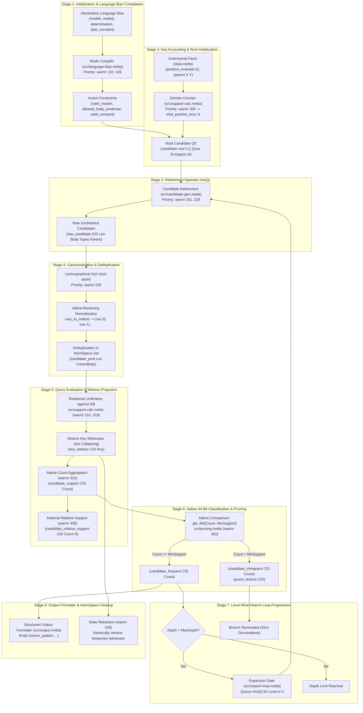

# WARMR: Foundations, System Architecture, and Algorithmic Mechanics

**A Beginner-Friendly, Mathematically Rigorous Guide to Relational Association Mining in MeTTa/MM2 on MORK**

---

## 1. Executive Summary & Beginner Intuition

### 1.1. The Core Problem: Why Standard Data Mining Fails on Relational Data

Most people learn data mining through algorithms like **Apriori** or **FP-Growth**. These algorithms are designed for **flat, single-table transactions** (like supermarket shopping carts):

| Transaction ID | Items Bought |
|---|---|
| Cart #1 | `{ Bread, Butter, Milk }` |
| Cart #2 | `{ Beer, Diapers }` |
| Cart #3 | `{ Bread, Butter }` |

From this flat table, finding rules like `"If Bread, then Butter"` is straightforward because:
1. Every row is an independent observation of identical type.
2. Every item is an atomic categorical symbol.
3. There are no links, pointers, or foreign keys connecting Cart #1 to Cart #2.

#### But Real-World Data is a Connected Web
In biology, medicine, cyber-security, social networks, and enterprise databases, knowledge is never flat. It lives across multiple tables or knowledge graph hyperedges:

```
[Patient Table] ──── (1-to-many) ────> [Hospital Visits]
       │                                       │
       │ (1-to-many)                           │ (1-to-many)
       v                                       v
[Genetic Mutations]                     [Prescriptions] ────> [Medications]
```

If we try to force this multi-relational database into a single flat spreadsheet by joining tables, two catastrophic problems occur:
1. **Denormalization Bias (Artificial Count Distortion):** A patient with 20 hospital visits and 50 prescriptions gets duplicated 1,000 times in the joined table. A patient with 1 visit gets only 1 row. Any count of symptoms or drug interactions becomes wildly distorted.
2. **Loss of Relational Topology:** Information about *how* entities are linked across multi-hop chains (e.g., *"Patient $X$ was treated by Doctor $Y$, who previously treated Patient $Z$ who had Condition $C$"*) is lost or turned into an explosion of synthetic columns.

### 1.2. What is WARMR?

**WARMR** (*W-Apriori for Mining Relational association rules*), introduced by Luc Dehaspe and Hannu Toivonen (1999), bridges the gap between **Inductive Logic Programming (ILP)** and **Association Rule Mining**.

Instead of mining combinations of columns in a flat table, WARMR searches for patterns expressed as **First-Order Horn Clause Logic (Datalog)** queries:
$$? - \text{key}(X), P_1(X, Y), P_2(Y, Z), \dots$$

```
Real-World Example (Medical Knowledge Discovery):
"Find all patterns that hold true for at least 15% of all cancer patients."

One candidate pattern might be:
?- Patient(X), Diagnosis(X, BreastCancer), Prescribed(X, DrugY), HasGene(X, BRCA1).
```

### 1.3. Real-World Analogy: The Detective Investigation

To understand how WARMR works from a beginner's perspective, imagine a lead detective looking for criminal patterns across a city:

```
Step 0 (Most General):
Detective: "Let's investigate every Person (X) in our criminal registry."
Result: 1,000 total people (This is our 100% baseline).

Step 1 (Level 1 Specialization):
Detective: "How many people (X) own a licensed firearm?"
Result: 250 people (25% support -> Frequent! Keep exploring this branch.)

Detective: "How many people (X) own a private submarine?"
Result: 1 person (0.1% support -> INFREQUENT! Prune this branch immediately!)

Step 2 (Level 2 Specialization - Anti-Monotonicity in Action):
The detective adds another detail ONLY to the frequent firearm branch:
"How many people (X) own a firearm AND have an offshore bank account (Y)?"
Result: 60 people (6% support -> Frequent!)

Notice what the detective DOES NOT DO:
The detective NEVER asks: "How many people own a private submarine AND have an offshore bank account?"
Why? Because if only 1 person owns a submarine, adding more requirements can NEVER increase that number!
It will always be 1 or 0.
```

This common-sense pruning rule is mathematically formalized as the **Anti-Monotonicity Principle** (or the Apriori property).

---

## 2. Core Concepts and Terminology

| Concept | Plain English Definition | Datalog / MeTTa Syntax |
|---|---|---|
| **First-Order Atom** | A relationship predicate applied to arguments (variables or constants). | `(parent $x $y)`, `(gender $x female)` |
| **Variable** | A placeholder representing an entity. In MORK, standardized as indexed terms. | `(var 0)`, `(var 1)`, `(var 2)` |
| **Substitution ($\theta$)** | An assignment mapping variables to concrete database entities. | `{(var 0) -> abel, (var 1) -> hana}` |
| **Key Entity ($K$)** | The designated "unit of analysis" being counted. | `(positive_example abel)` |
| **Key Projection** | Projecting a multi-variable match tuple onto only the key variable. | If `(X=abel, Y=hana, Z=sami)` matches, key is `abel`. |
| **Support (Frequency)** | The count of **distinct key individuals** that satisfy the query. | 5 out of 20 people satisfy the pattern. |
| **Minimum Support ($minsupp$)** | The cutoff threshold. Queries with support $< minsupp$ are discarded. | `MIN_SUPPORT = 2` |
| **Language Bias (WRMODE)** | Declarative constraints specifying which queries are legal to construct. | `modeh`, `modeb`, `determination` |
| **Input Slot (`+`)** | An argument in an added literal that **must** link to an already existing variable. | Ensures query connectedness back to key. |
| **Output Slot (`-`)** | An argument in an added literal that introduces a **fresh** variable. | Expands the relational chain forward. |
| **Constant Slot (`#`)** | An argument in an added literal that binds to a ground constant domain value. | `(gender (var 0) (const female))` |
| **Refinement Operator ($\rho$)** | A function that takes a query $Q$ and yields all valid 1-step extensions. | $\rho(Q) = \{ Q \wedge L_1, Q \wedge L_2, \dots \}$ |
| **Anti-Monotonicity** | If query $Q$ is infrequent, any specialization $Q \wedge L$ is guaranteed infrequent. | $Q \preceq_\theta Q' \implies \text{supp}(Q') \le \text{supp}(Q)$ |
| **Canonicalization** | Renaming variables and sorting atoms so identical queries have identical text. | Prevents testing $P(X,Y) \wedge Q(Y)$ and $Q(B) \wedge P(A,B)$ twice. |

---

## 3. Mathematical Foundations

### 3.1. Query Satisfaction and Models

Let $\mathcal{D}$ represent the extensional database of relational ground facts (e.g., `(parent abel hana)`), and let $\mathcal{B}$ represent intensional background knowledge (e.g., recursive Datalog deductive rules like `ancestor/2`).

A relational query is written as:
$$Q = ? - \text{key}(X), \text{Body}(X, \vec{Y})$$
where $X$ is the key variable and $\vec{Y} = \langle Y_1, \dots, Y_m \rangle$ is a vector of existential auxiliary variables.

A key individual $k \in \mathcal{K}$ satisfies query $Q$ with respect to $\mathcal{D} \cup \mathcal{B}$ if and only if:
$$\mathcal{D} \cup \mathcal{B} \models \exists \vec{Y} \text{Body}(k, \vec{Y})$$

In terms of substitutions, this means there exists at least one substitution $\theta$ such that:
$$\theta(X) = k \quad \text{and} \quad \text{Body}(k, \theta(\vec{Y})) \subseteq \mathcal{D} \cup \mathcal{B}$$

### 3.2. Key-Projected Relational Support (The Counting Metric)

Let $\mathcal{K} = \{ k \mid \text{key}(k) \in \mathcal{D} \}$ be the finite set of key domain individuals, with total size $N = |\mathcal{K}|$.

The **Absolute Support** of query $Q$ over database $\mathcal{D}$ is defined as:
$$\text{supp}_{\mathcal{D}}(Q) = \left| \left\{ k \in \mathcal{K} \;\middle|\; \mathcal{D} \cup \mathcal{B} \models \exists \vec{Y} \text{Body}(k, \vec{Y}) \right\} \right|$$

The **Relative Support** is:
$$\text{rel\_supp}_{\mathcal{D}}(Q) = \frac{\text{supp}_{\mathcal{D}}(Q)}{|\mathcal{K}|} = \frac{\text{supp}_{\mathcal{D}}(Q)}{N}$$

#### Crucial Principle: Multi-Proof Collapsing
Suppose an individual `abel` has 3 children: `hana`, `sami`, and `bereket`.  
Consider the query:
$$Q(X) = ? - \text{parent}(X, Y)$$

There are 3 distinct substitution proofs:
1. $\theta_1 = \{ X \mapsto \text{abel}, Y \mapsto \text{hana} \}$
2. $\theta_2 = \{ X \mapsto \text{abel}, Y \mapsto \text{sami} \}$
3. $\theta_3 = \{ X \mapsto \text{abel}, Y \mapsto \text{bereket} \}$

Under WARMR's key-projected semantics, all three substitutions project onto the exact same key individual:
$$\pi_X(\theta_1) = \text{abel}, \quad \pi_X(\theta_2) = \text{abel}, \quad \pi_X(\theta_3) = \text{abel}$$

Because MORK stores witnesses as unique atoms in its PathMap binary tree set:
$$\text{Witness Set} = \{ \text{abel} \}$$
`abel` contributes **exactly 1** to the support of $Q$. Support answers the question: *"How many parents are there?"*, not *"How many parent-child tuples exist?"*.

### 3.3. $\theta$-Subsumption and Safe Pruning

**Definition ($\theta$-Subsumption):**  
A query $Q_1$ $\theta$-subsumes a query $Q_2$ (denoted $Q_1 \succeq_\theta Q_2$, meaning $Q_1$ is at least as general as $Q_2$) if and only if there exists a substitution $\theta$ such that:
$$\text{Body}(Q_1)\theta \subseteq \text{Body}(Q_2)$$

**Theorem (Anti-Monotonicity of Key Support):**  
If $Q_1 \succeq_\theta Q_2$, then for any database $\mathcal{D}$:
$$\text{supp}_{\mathcal{D}}(Q_2) \le \text{supp}_{\mathcal{D}}(Q_1)$$

*Proof:*  
Let $k \in \mathcal{K}$ be an arbitrary key entity that satisfies $Q_2$. By definition, there exists a substitution $\sigma$ such that $\sigma(X) = k$ and $\text{Body}(Q_2)\sigma \subseteq \mathcal{D}$.  
Because $Q_1 \succeq_\theta Q_2$, we have $\text{Body}(Q_1)\theta \subseteq \text{Body}(Q_2)$.  
Applying $\sigma$ to both sides gives $\text{Body}(Q_1)(\theta \circ \sigma) \subseteq \text{Body}(Q_2)\sigma \subseteq \mathcal{D}$.  
Thus, the composite substitution $(\theta \circ \sigma)$ witnesses that $k$ also satisfies $Q_1$.  
Every key entity satisfying $Q_2$ must therefore satisfy $Q_1$.  
Hence, $|\text{Witnesses}(Q_2)| \le |\text{Witnesses}(Q_1)|$. $\blacksquare$

**Algorithmic Implication:**  
If $\text{supp}(Q_1) < minsupp$, then for any specialization $Q_2 = Q_1 \wedge L$, $\text{supp}(Q_2) \le \text{supp}(Q_1) < minsupp$.  
Therefore, **$Q_2$ can never be frequent**. WARMR prunes $Q_1$ immediately, saving massive amounts of database evaluation.

---

## 4. End-to-End System Architecture on MORK

The WARMR engine is implemented entirely in **MeTTa/MM2** running on **MORK** (Mork Operating Rule Kernel). MORK is a deterministic term-rewriting engine implemented in Rust that organizes rules into priority-tagged execution buckets.

### 4.1. Complete Architectural Pipeline



### 4.2. MORK Priority Tags: The Orchestration Backbone

In MORK, rules are evaluated deterministically in ascending priority order. The pipeline coordinates its stages using reserved priority namespaces:

| Priority Tag Range | Subsystem | File | Function |
|---|---|---|---|
| `warmr 050..052` | Recursive Datalog Engine | `benchmarks/recursive-family.metta` | Pre-computes intensional deductions (e.g. `ancestor/2` transitive closure). |
| `warmr 110..149` | Language-Bias Compiler | `src/language-bias.metta` | Compiles user `modeh`, `modeb`, and type declarations into active search filters. |
| `warmr 150..199` | Pipeline Coordinator | `src/warmr.metta` | Spawns domain counter and boots the Level 0 root candidate $Q_0$. |
| `warmr 201..229` | Candidate Generation ($\rho$) | `src/candidate-gen.metta` | Implements refinement operator across predicate arities 1, 2, 3, and 4. |
| `warmr 230..249` | Canonicalization Engine | `src/canonicalize.metta` | Normalizes literal order (`sort-atom`) and variable indices ($\alpha$-renaming). |
| `warmr 305..309` | Domain Accounting | `src/support-calc.metta` | Counts total positive key entities ($N$). |
| `warmr 310..319` | Relational Unification | `src/support-calc.metta` | Unifies candidate conjunctions against AtomSpace facts; emits witnesses. |
| `warmr 320..329` | Witness Counting | `src/support-calc.metta` | Tallies distinct witnesses via MORK's native `count` accumulator sink. |
| `warmr 330..339` | Ratio Calculation | `src/support-calc.metta` | Calculates exact rational relative support (`Count / N`). |
| `warmr 340..349` | State Cleanup | `src/support-calc.metta` | Retracts temporary `key_witness` atoms, ensuring 0 memory leaks. |
| `warmr 350..364` | Native 64-Bit Pruning | `src/pruning.metta` | Invokes native `gte_i64` against `$min_supp`; classifies candidates. |
| `warmr 365..549` | Dynamic BFS Progression | `src/search-loop.metta` | Drives breadth-first level transitions from Level 1 up to Level 8. |
| `warmr 560..569` | Output Formatter | `src/output.metta` | Formats and prints structured `(warmr_pattern ...)` records. |
| `warmr 570..599` | Search Termination | `src/search-loop.metta` | Emits termination audit records and search completion summaries. |

---

## 5. Algorithmic Mechanics: Step-by-Step

### Step 1: Language Bias Compilation
Before exploring patterns, the user defines the search space using declarative mode declarations:
```metta
;; Target: Study people
(modeh positive_example ((+ person)))

;; Allowed Relations:
(modeb 1 parent ((+ person) (- person)))
(modeb 1 gender ((+ person) (# gender_type)))

;; Constants pool:
(type_constant gender_type female)
(type_constant gender_type male)
```
The mode compiler (`src/language-bias.metta`) compiles these declarations into active validation facts. This guarantees that WARMR will never generate meaningless queries like `gender(sami, abel)` or disconnected Cartesian products like `parent(X, Y) AND parent(A, B)`.

### Step 2: Candidate Generation via Refinement ($\rho$)
The refinement operator $\rho(Q)$ takes an existing frequent query and produces all legal single-literal specializations:
1. **Input variables (`+`):** Must bind to a variable that already exists in the parent query with matching type.
2. **Output variables (`-`):** Must introduce a brand new variable, expanding the relational chain.
3. **Constant arguments (`#`):** Must bind to an active constant declared in the constant pool.

### Step 3: Canonicalization and Deduplication
Because conjunction in logic is commutative ($A \wedge B \equiv B \wedge A$) and variable names are arbitrary ($P(X, Y) \equiv P(A, B)$), naive generation produces massive duplication.  
The canonicalization engine (`src/canonicalize.metta`) applies a three-pass transformation:
1. **Sort Atoms:** Body literals are lexicographically sorted using MORK's pure `sort-atom` primitive.
2. **Variable Normalization:** Variables are remapped sequentially from left to right as `(var 0)`, `(var 1)`, `(var 2)`, etc.
3. **Set Insertion:** The canonicalized query string is placed into an AtomSpace candidate pool. If an identical pattern was already generated through another path, it is discarded instantly.

### Step 4: Query Evaluation and Witness Projection
The candidate query is compiled into an AtomSpace pattern match:
```metta
;; For query: parent(X, Y) AND parent(Y, Z)
(exec (warmr 315 eval_chain)
  ((candidate_eval $cid ((parent (var 0) (var 1)) (parent (var 1) (var 2))))
   (parent $x $y)
   (parent $y $z))
  ((+ (key_witness $cid $x))))
```
Every satisfying database match emits a `(key_witness $cid $x)` atom. Because MORK operates on a set-based PathMap, duplicate emissions of the same key `$x` collapse into a single entry.

### Step 5: Native 64-Bit Counting and Support Classification
Once all witnesses are emitted, MORK's native accumulator counts the distinct witnesses:
```metta
(exec (warmr 320 count_witnesses)
  ((count (witness_sink $cid $cnt) (key_witness $cid $x) $cnt))
  ((+ (candidate_support $cid $cnt))))
```
Next, `src/pruning.metta` compares `$cnt` against `$min_supp` using MORK's pure 64-bit integer comparator:
```metta
(exec (warmr 350 classify)
  ((candidate_support $cid $cnt)
   (min_support_threshold $min)
   (gte_i64 $cnt $min))
  ((+ (candidate_frequent $cid $cnt))))
```
- If `gte_i64` succeeds: the candidate is marked **Frequent**.
- If `gte_i64` fails: the candidate is marked **Infrequent** and a `(prune_branch $cid)` token is generated.

### Step 6: Level-Wise Breadth-First Progression
Frequent candidates are placed in the expansion queue for the next level. Infrequent branches are pruned—none of their descendants will ever be generated or tested. The search proceeds to Level $k+1$ until either:
1. The candidate frontier becomes empty (all branches pruned), or
2. The user-configured `max_depth` (up to depth 8) is reached.

---

## 6. Real-World Worked Walkthrough: The Family Domain

Let us trace a complete execution on a real family dataset.

### Database Facts ($\mathcal{D}$):
```metta
(parent abel hana)
(parent hana sami)
(parent hana lidiya)
(parent bereket sara)
(parent sara noah)
```
Key Individuals ($\mathcal{K}$): `abel`, `hana`, `sami`, `lidiya`, `bereket`, `sara`, `noah` ($N = 7$).  
Threshold: `min_support = 2`.

```
================================================================================
LEVEL 0 (Root):
Candidate Q0: positive_example(X)
Matches: All 7 individuals.
Support: 7 / 7 (100%) -> FREQUENT. Proceed to Level 1.
================================================================================

LEVEL 1 (Single-literal extensions rho(Q0)):
Candidate 1A: parent((var 0), (var 1))  ["Is a parent"]
Witnesses:
  - abel (parent of hana)
  - hana (parent of sami, lidiya)
  - bereket (parent of sara)
  - sara (parent of noah)
Distinct Witnesses: {abel, hana, bereket, sara} -> Count = 4
Support: 4 / 7 (57.1%) >= 2 -> FREQUENT! (Retained)

Candidate 1B: parent((var 1), (var 0))  ["Is a child"]
Witnesses:
  - hana (child of abel)
  - sami (child of hana)
  - lidiya (child of hana)
  - sara (child of bereket)
  - noah (child of sara)
Distinct Witnesses: {hana, sami, lidiya, sara, noah} -> Count = 5
Support: 5 / 7 (71.4%) >= 2 -> FREQUENT! (Retained)

================================================================================
LEVEL 2 (Two-literal extensions rho(Q1)):
Candidate 2A: parent((var 0), (var 1)) AND parent((var 1), (var 2))  ["Grandparent"]
Database Matches:
  1. abel -> hana -> sami
  2. abel -> hana -> lidiya
  3. bereket -> sara -> noah
Witness Projections:
  - Match 1 projects to: abel
  - Match 2 projects to: abel (Collapses with Match 1!)
  - Match 3 projects to: bereket
Distinct Witnesses: {abel, bereket} -> Count = 2
Support: 2 / 7 (28.6%) >= 2 -> FREQUENT! (Retained)

Candidate 2B: parent((var 0), (var 1)) AND parent((var 0), (var 2))  ["Has at least two children"]
Database Matches:
  1. hana -> (sami, lidiya)
Distinct Witnesses: {hana} -> Count = 1
Support: 1 / 7 (14.3%) < 2 -> INFREQUENT!
ACTION: PRUNE BRANCH! (Never expand Candidate 2B into Level 3!)
================================================================================
```

### Resulting Discoveries:
```text
(warmr_pattern 1 1 ((parent (var 0) (var 1))) 4 4/7)
(warmr_pattern 2 1 ((parent (var 1) (var 0))) 5 5/7)
(warmr_pattern 3 2 ((parent (var 0) (var 1)) (parent (var 1) (var 2))) 2 2/7)
```

---

## 7. Association Rules vs. Frequent Patterns (Phase 1 vs. Phase 2)

A common point of confusion for beginners is the difference between:
1. **Frequent Pattern Discovery (Phase 1 - WARMR's Core)**
2. **Association Rule Generation (Phase 2 - Post-Processing)**

### What WARMR Solves (Phase 1)
WARMR's sole algorithmic responsibility is to discover all conjunctions of relational literals whose key support meets or exceeds the minimum threshold:
$$\mathcal{F} = \{ Q \in \mathcal{L} \mid \text{supp}(Q) \ge minsupp \}$$

### Downstream Rule Generation (Phase 2)
Once the frequent patterns $\mathcal{F}$ are discovered, a simple post-processing phase can construct association rules of the form:
$$Q_1 \Rightarrow Q_2 \quad (\text{where } Q_1 \subset Q_2)$$

The **Confidence** of such a rule is the conditional probability that a key entity satisfies $Q_2$ given that it satisfies $Q_1$:
$$\text{conf}(Q_1 \Rightarrow Q_2) = \frac{\text{supp}(Q_2)}{\text{supp}(Q_1)}$$

*Example:*  
Using our family example:
* $Q_1 = \text{parent}(X, Y)$ (Support = 4)
* $Q_2 = \text{parent}(X, Y) \wedge \text{parent}(Y, Z)$ (Support = 2)

The derived rule is:
$$\text{parent}(X, Y) \Longrightarrow \text{parent}(Y, Z) \quad [\text{Support} = 2/7, \;\; \text{Confidence} = 2/4 = 50\%]$$
*"50% of all parents in this database are also grandparents."*

Notice that calculating confidence requires **no new database queries**! It is a pure arithmetic division over the supports already computed in Phase 1. As specified in the ILP literature and `Task.pdf`, Phase 1 is the primary search engine; Phase 2 is straightforward downstream post-processing.

---

## 8. Summary of Strengths and Engineering Bounds

### Confirmed Engine Strengths:
1. **First-Principles Relational Support:** Implements genuine key-witness projection, eliminating denormalization count bias in multi-relational graphs.
2. **Multi-Arity Support:** Natively supports relations of arity 1 (`unary`), arity 2 (`binary`), arity 3 (`ternary`), and arity 4 (`4-ary`).
3. **Recursive Datalog Background Knowledge:** Seamlessly evaluates transitive closures (e.g. `ancestor/2`) prior to pattern mining.
4. **Declarative Language Bias (WRMODE):** Restricts the search space to semantically meaningful, connected queries using `+`, `-`, and `#` slot designations.
5. **Zero Memory Leaks:** Atomically retracts intermediate witness atoms after each level pass.

### Genuine Engineering Scope and Limitations:
- **Search Depth Bound:** Templated and verified up to depth 8. Searching beyond depth 8 requires extending priority stage transitions. (In practice, ILP searches rarely exceed depth 4–5 due to combinatorial explosion).
- **Subsumption Equivalence:** Applies syntactic canonicalization (atom sorting and $\alpha$-renaming). It does not compute full NP-complete semantic $\theta$-subsumption (e.g. graph self-folding).
- **Monotonicity:** Designed strictly for positive definite Horn clauses. Non-monotonic negation (Negation-as-Failure) is excluded because it invalidates anti-monotonic pruning.
