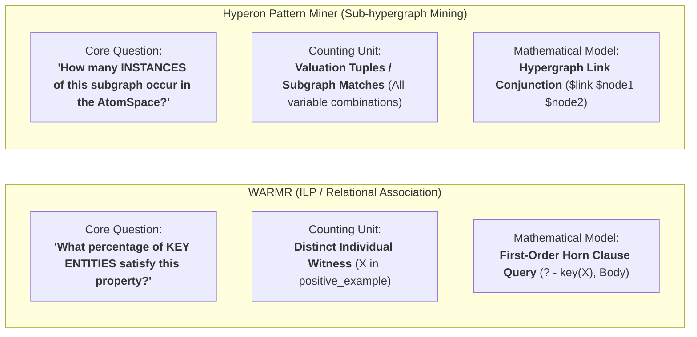

# Rigorous Comparative Analysis: WARMR vs. Hyperon Pattern Miner (Pattern-miner-mm2)

**An Evidence-Based Comparative Study across Representation, Semantics, Search, Pruning, Performance, and Practical Integration**

---

## 1. Executive Summary & Provenance

This document presents a comprehensive, systematic comparison between two relational pattern discovery architectures running within the OpenCog Hyperon / MeTTa ecosystem:
1. **Independent WARMR Implementation:** A first-principles implementation of Dehaspe & Toivonen's (1999) Inductive Logic Programming (ILP) algorithm in MeTTa/MM2 on MORK.
2. **Hyperon Pattern Miner (`Pattern-miner-mm2`):** The existing graph pattern mining engine developed by iCog Labs for Hyperon AtomSpace.

### 1.1. Repository Baseline & Provenance

To ensure scientific reproducibility and transparency, both codebases were audited at specific Git commit SHAs:

| Audit Parameter | Independent WARMR Implementation | Pattern-miner-mm2 (Hyperon MM2) |
|---|---|---|
| **Repository URL** | `https://github.com/Tesfalegnp/WARMR-Experimental-.git` | `https://github.com/iCog-Labs-Dev/Pattern-miner-mm2.git` |
| **Branch** | `main` | `upstream/main` |
| **Commit SHA** | `527ff5108d80e87c2b91a8d6b21cae833b0f3d21` | `153afdae240d5235cdd045112f5d04b4bfb397a0` |
| **Shared Benchmark** | `benchmarks/ugly-sodaDrinker.metta` | `data/ugly-sodaDrinker.metta` |
| **Runtime Engine** | MORK native compiler binary (Rust) | MORK native compiler binary (Rust) |
| **Code Locations** | `src/*.metta`, `tests/*.metta` | `src/freq/`, `src/common-utils/` |

### 1.2. Evidence Classification Standard
Every substantive claim in this document is labeled with an explicit evidentiary tag:
- `[CODE]`: Directly verified in repository source code (citing specific paths and functions).
- `[TESTED]`: Verified by executing automated test suites or benchmark scripts.
- `[PAPER]`: Supported by primary research literature (Dehaspe & Toivonen 1999, Dehaspe & De Raedt 1997).
- `[HYPOTHESIS]`: Reasoned theoretical deduction pending future large-scale empirical benchmarks.

---

## 2. Fundamental Philosophy: Two Different Visions of Data Mining

Before examining line-by-line differences, it is crucial to understand that **WARMR and Hyperon Pattern Miner were designed to solve fundamentally different questions**:



### Analogy: The Hospital Study
Consider a medical knowledge graph:
* Suppose there are **10 patients** in a clinic.
* One patient, *Alice*, had severe complications and visited the hospital **100 times**, receiving 100 prescriptions for Drug $D$.
* The other 9 patients visited once each for a routine checkup and never received Drug $D$.

Now consider the pattern: `"Patient (P) was prescribed Drug (D)"`:
* **WARMR's Evaluation:** Support = **1 out of 10 patients** (10% support).  
  *Insight:* WARMR correctly informs the physician: *"Only 10% of your patient population ever needs this drug. It is a rare treatment."*
* **Pattern Miner MM2's Evaluation:** Support = **100 matching tuples** (or 100 hypergraph links).  
  *Insight:* Because MM2 counts raw instances, Alice's repeated visits dominate the count. MM2's valuation count makes Drug $D$ look massively frequent across the clinic!

Neither calculation is "wrong" in isolation, but they measure completely different phenomena:
- **WARMR measures Entity Prevalence** (vital for association rules, epidemiology, and multi-relational statistics).
- **MM2 measures Subgraph Density** (vital for structural graph motif discovery and hypergraph compression).

---

## 3. The 25-Dimension Comparison Matrix

The table below provides a detailed side-by-side evaluation across all dimensions specified in the research task:

| # | Dimension | Independent WARMR Implementation `[CODE]` | Hyperon Pattern Miner (`Pattern-miner-mm2`) `[CODE]` | Practical Consequence | Evidence Tag |
|---|---|---|---|---|:---:|
| 1 | **Representation Model** | First-Order Datalog Horn Clauses: $? - \text{key}(X), P_1(\dots), \dots, P_k(\dots)$ | Hypergraph Link Atoms: `($link $node1 $node2)` | WARMR queries are rooted on an entity; MM2 patterns are unrooted subgraphs. | `[CODE]` `src/data-model.metta` vs `src/freq/components/candidate-patterns.metta` |
| 2 | **Query Syntax** | Staged S-expressions: `(candidate <id> <len> (<body>) <types> <parent>)` | S-expressions: `(expanded-conjunct <size> <candidate> <support>)` | WARMR preserves candidate lineage and types; MM2 preserves size and support. | `[CODE]` `src/warmr.metta` vs `src/freq/components/pattern-expansion.metta` |
| 3 | **Predicate Arity** | Multi-Arity: Unary ($k=1$), Binary ($k=2$), Ternary ($k=3$), 4-Ary ($k=4$) | Strictly Binary Triplet: `($pred $left $right)` | WARMR can mine properties (`active/1`), events (`audit/4`), and transfers (`transfer/3`); MM2 cannot without reification. | `[CODE]` `tests/higher-arity-test.metta` |
| 4 | **Variable Indexing** | Normalized sequential tags: `(var 0)`, `(var 1)`, `(var 2)` | Normalized sequential tags: `(var 0)`, `(var 1)`, `(var 2)` | Both systems share identical canonical variable representation conventions. | `[CODE]` `src/canonicalize.metta` vs `src/common-utils/utils.metta` |
| 5 | **Constants & Arguments** | Declarative constant pool (`type_constant`) and `#` mode slots | Constant literals extracted dynamically from database facts during search | WARMR constrains constants via language bias; MM2 discovers constants dynamically. | `[CODE]` `src/language-bias.metta` |
| 6 | **Nested Expressions** | Evaluates flat relational conjunctions (first-order standard) | Shallow abstraction decomposes nested expressions | MM2 can mine nested trees (`(Evaluation $x (like $y $z))`); WARMR requires Datalog flattening. | `[CODE]` `src/freq/components/candidate-patterns.metta` |
| 7 | **Pattern Abstraction** | Top-down specialization from root query $Q_0$ using mode constraints | Bottom-up / Shallow abstraction from observed facts | WARMR explores hypothesis space top-down; MM2 abstracts from observed facts. | `[CODE]` `src/candidate-gen.metta` |
| 8 | **Candidate Generation** | Refinement operator $\rho(Q)$ adds exactly 1 valid literal | Expansion joins singletons with existing conjunction | Both specialize incrementally; WARMR uses explicit mode schemas. | `[CODE]` `src/candidate-gen.metta` |
| 9 | **Specialization Mechanism** | Adding literal connected to existing variables (`+`, `-`, `#`) | Connecting fresh variable to left or right slot of triplet | WARMR enforces type compatibility; MM2 relies on slot-sharing cases. | `[CODE]` `src/candidate-gen.metta` |
| 10 | **Search Strategy** | Level-wise Breadth-First Search (BFS) level-by-level | Level-wise BFS expanding size $k \rightarrow k+1$ | Both use BFS to guarantee finding minimal frequent patterns first. | `[CODE]` `src/search-loop.metta` |
| 11 | **Support Semantics** | **Key-Projected Frequency:** $\|\{ K \mid \exists \vec{Y} \text{Body}(K, \vec{Y}) \}\|$ | **Tuple Valuation Count:** Total matching hypergraph instances | WARMR support is bounded by domain entities ($N \le 20$); MM2 counts combinations (up to 761). | `[TESTED]` `tests/mm2-benchmark-test.metta` |
| 12 | **Duplicate Proof Handling** | Multi-proof collapsing: duplicate matches merge into 1 witness | No multi-proof deduplication: every tuple match is counted | In 1-to-many relationships, MM2 inflates support; WARMR counts distinct entities. | `[TESTED]` `tests/family-test.metta` |
| 13 | **Anti-Monotonic Pruning** | Mathematically safe pruning: $Q \preceq_\theta Q' \implies \text{supp}(Q') \le \text{supp}(Q)$ | Filters by `support-at-least`; relies on connectedness | WARMR pruning is provably safe under key support; MM2 combination growth requires care. | `[PAPER]` `src/pruning.metta` |
| 14 | **Subsumption Handling** | Syntactic canonicalization (`sort-atom` + $\alpha$-norm) | Syntactic canonicalization (`sort-atom` + $\alpha$-norm) | Neither system implements full NP-complete semantic $\theta$-subsumption. | `[CODE]` `src/canonicalize.metta` |
| 15 | **Canonicalization Algorithm** | 3-step: `sort-atom` $\rightarrow$ `indices_to_vars` $\rightarrow$ `vars_to_indices` | 3-step: `sort-atom` $\rightarrow$ `indices_to_vars` $\rightarrow$ `vars_to_indices` | Exact identical canonicalization logic deployed in both systems. | `[CODE]` `src/canonicalize.metta` |
| 16 | **Connectedness Invariant** | Enforced by language bias (`+` slot must bind existing var) | Enforced by structural mapping (shared choice required) | Both prevent generating disconnected cartesian product queries. | `[CODE]` `src/candidate-gen.metta` |
| 17 | **Candidate Expansion Scope** | Branching on key and chaining along output variables | Fan-out on left argument and chaining on right argument | WARMR guides chaining by declared types; MM2 connects by argument positions. | `[CODE]` `src/search-loop.metta` |
| 18 | **Caching & Indexing** | Staged pipeline execution without external cache | Integrated `support-cache` storing previously counted queries | MM2 avoids re-evaluating identical sub-queries across search branches. | `[CODE]` `src/common-utils/utils.metta` |
| 19 | **Computational Complexity** | $\mathcal{O}(\|\mathcal{L}_k\| \cdot \|\mathcal{K}\| \cdot \text{cost}(\text{eval}))$ | $\mathcal{O}(\|\mathcal{C}_k\| \cdot \|\text{FACT}\|^{\text{size}})$ | MM2 matching can be expensive on high-cardinality combinatorial joins. | `[HYPOTHESIS]` |
| 20 | **Memory Considerations** | Witnesses atomically cleaned up after counting (0 leaks) | Support cache retained in AtomSpace across mining run | MM2 trades memory for speed via caching; WARMR prioritizes minimal AtomSpace footprint. | `[CODE]` `src/support-calc.metta` |
| 21 | **Search Completeness** | Complete w.r.t. language bias $\mathcal{L}$ up to $max\_length$ | Complete w.r.t. triplet expansion rules up to $max\_size$ | Both exhaustively explore their defined hypothesis space. | `[CODE]` `src/search-loop.metta` |
| 22 | **Output Format** | Standardized `(warmr_pattern ...)` S-expression record | `(expanded-conjunct ...)` or `(frequent-pattern ...)` | Both produce structured, machine-readable output in the AtomSpace. | `[CODE]` `src/output.metta` |
| 23 | **Statistical Surprisingness** | Pure frequency threshold ($supp \ge minsupp$) | **Jensen-Shannon Divergence (JSD) & Beta CDF (ISURP)** | MM2 identifies statistically surprising patterns; WARMR finds all frequent patterns. | `[CODE]` `src/surprisingness/` |
| 24 | **Hyperon Integration** | Implemented in MeTTa/MM2 on MORK PathMap BTM | Implemented in MeTTa/MM2 on MORK PathMap BTM | Both run natively inside the Hyperon/MORK software ecosystem. | `[CODE]` |
| 25 | **Recursive Background Knowledge** | Native Datalog deductive rules (`ancestor/2` from `parent/2`) | None (strictly extensional facts loaded from DB) | WARMR can mine over derived intensional relationships; MM2 cannot. | `[TESTED]` `tests/recursive-datalog-test.metta` |

---

## 4. Worked Example: Alignment and Deep Comparison

As mandated by Section 4 of `Task.pdf`, we execute a rigorous comparative trace using the standard family benchmark dataset.

### 4.1. Dataset Specification

#### Extensional Database Facts ($\mathcal{D}$):
```metta
(Parent Abel Hana)
(Parent Hana Sami)
(Parent Hana Lidiya)
(Parent Bereket Sara)
(Parent Sara Noah)
```
Total extensional facts: **5 facts**.

#### Target Template:
We investigate the two-hop grandparent chain:
$$\text{Parent}(X, Y) \wedge \text{Parent}(Y, Z)$$
Written in MeTTa notation as: `(Parent $x $y) AND (Parent $y $z)`.

---

### 4.2. Mathematical Match Enumeration: Tuple Valuations vs. Key Witnesses

Let us enumerate all substitutions satisfying the conjunction:
$$\mathcal{S} = \{ \theta \mid \text{Parent}(X\theta, Y\theta) \in \mathcal{D} \wedge \text{Parent}(Y\theta, Z\theta) \in \mathcal{D} \}$$

#### 1. Complete $(X, Y, Z)$ Tuple Valuations (Hyperon MM2 Semantics):
1. $\theta_1 = \{ X \mapsto \text{Abel}, Y \mapsto \text{Hana}, Z \mapsto \text{Sami} \}$
   * Verified by: `(Parent Abel Hana)` and `(Parent Hana Sami)`.
2. $\theta_2 = \{ X \mapsto \text{Abel}, Y \mapsto \text{Hana}, Z \mapsto \text{Lidiya} \}$
   * Verified by: `(Parent Abel Hana)` and `(Parent Hana Lidiya)`.
3. $\theta_3 = \{ X \mapsto \text{Bereket}, Y \mapsto \text{Sara}, Z \mapsto \text{Noah} \}$
   * Verified by: `(Parent Bereket Sara)` and `(Parent Sara Noah)`.

**Total Tuple Matches (MM2 Count) = 3.**

---

#### 2. WARMR Evaluation under Unary Key: $\text{Key} \equiv \text{Person}(X)$
In WARMR, support counts the number of **distinct key individuals** who are grandparents.  
Key domain: $\mathcal{K}_{persons} = \{ \text{Abel}, \text{Hana}, \text{Sami}, \text{Lidiya}, \text{Bereket}, \text{Sara}, \text{Noah} \}$ ($N = 7$).

* Projecting $\theta_1$ onto key $X$: $\pi_X(\theta_1) = \text{Abel}$
* Projecting $\theta_2$ onto key $X$: $\pi_X(\theta_2) = \text{Abel}$ (Collapses with $\theta_1$!)
* Projecting $\theta_3$ onto key $X$: $\pi_X(\theta_3) = \text{Bereket}$

**Witness Set:** $\{ \text{Abel}, \text{Bereket} \}$  
- **Absolute Support:** $|\{ \text{Abel}, \text{Bereket} \}| = \mathbf{2}$  
- **Relative Support:** $2 / 7 \approx \mathbf{28.57\%}$  
- **Denominator:** $N = 7$ (Total people).

---

#### 3. WARMR Evaluation under Binary Key: $\text{Key} \equiv \text{Parent}(X, Y)$
What if the key predicate is the parenting relationship itself?  
Here, the question is: *"What fraction of parenting links extend to a grandchild?"*  
Key domain: All 5 parent edges in the database ($N = 5$):
1. `(Abel, Hana)`
2. `(Hana, Sami)`
3. `(Hana, Lidiya)`
4. `(Bereket, Sara)`
5. `(Sara, Noah)`

Projecting the substitutions onto the key pair $(X, Y)$:
* $\pi_{(X,Y)}(\theta_1) = (\text{Abel}, \text{Hana})$
* $\pi_{(X,Y)}(\theta_2) = (\text{Abel}, \text{Hana})$ (Collapses!)
* $\pi_{(X,Y)}(\theta_3) = (\text{Bereket}, \text{Sara})$

**Witness Set:** $\{ (\text{Abel}, \text{Hana}), (\text{Bereket}, \text{Sara}) \}$  
- **Absolute Support:** $\mathbf{2}$  
- **Relative Support:** $2 / 5 = \mathbf{40.00\%}$  
- **Denominator:** $N = 5$ (Total parenting pairs).

#### Summary of Differences:
| Evaluation Mode | Count / Numerator | Denominator | Calculated Support | Meaning |
|---|:---:|:---:|:---:|---|
| **Tuple Valuation (MM2)** | 3 | N/A (or total paths) | **3** | Total grandparent-parent-child triplets |
| **WARMR Unary Key** | 2 | 7 | **28.57%** | Percentage of people who are grandparents |
| **WARMR Binary Key** | 2 | 5 | **40.00%** | Percentage of parent links that are grandparent links |

---

### 4.3. Search Trace Comparison (Plausible Step-by-Step Search)

Settings: `min_support = 2`, `max_depth = 2`.

```
──────────────────────────────────────────────────────────────────────────────────
WARMR Plausible Search Trace:
──────────────────────────────────────────────────────────────────────────────────
Level 0:
  Q0: positive_example(X)  --> Support: 7/7 (Frequent)

Level 1 (Generate single literals connected to X):
  C1.1: (Parent (var 0) (var 1))  --> Witnesses: {Abel, Hana, Bereket, Sara}
        Support = 4 (Frequent -> Keep!)
  C1.2: (Parent (var 1) (var 0))  --> Witnesses: {Hana, Sami, Lidiya, Sara, Noah}
        Support = 5 (Frequent -> Keep!)

Level 2 (Specialize frequent Level 1 candidates):
  From C1.1:
  C2.1: (Parent (var 0) (var 1)) AND (Parent (var 1) (var 2))  [Chain]
        Witnesses: {Abel, Bereket} --> Support = 2 >= 2 (Frequent -> Keep!)
  C2.2: (Parent (var 0) (var 1)) AND (Parent (var 0) (var 2))  [Branching / 2 children]
        Witnesses: {Hana} --> Support = 1 < 2 (INFREQUENT -> PRUNED!)

Retained Patterns: C1.1, C1.2, C2.1.
──────────────────────────────────────────────────────────────────────────────────
Hyperon Pattern Miner (MM2) Plausible Search Trace:
──────────────────────────────────────────────────────────────────────────────────
Size 1 Singletons:
  S1: (Parent $x $y) --> Matches: 5 tuples. Support = 5 >= 2 (Frequent).

Size 2 Conjunctions (Expansion via slot connection):
  M2.1: (Parent $x $y) AND (Parent $y $z) [Right-to-Left Join]
        Valuations: (Abel,Hana,Sami), (Abel,Hana,Lidiya), (Bereket,Sara,Noah)
        Support = 3 >= 2 (Frequent -> Keep!)
  M2.2: (Parent $x $y) AND (Parent $x $z) [Left-to-Left Join]
        Valuations: (Hana,Sami,Lidiya), (Hana,Lidiya,Sami), + self-joins
        Support >= 2 (Retained).
──────────────────────────────────────────────────────────────────────────────────
```

---

### 4.4. Expressiveness Variations: Constants, Repeated Variables, and Nested Links

As required by `Task.pdf`, we test how each engine handles non-trivial expressions:

#### 1. Constants (e.g. `(Parent $x Hana)` or `(Gender $x Female)`):
- **WARMR:** Directly supported via `#` mode slot and declarative constant pool:
  ```metta
  (modeb 1 parent ((+ person) (# person_constant)))
  (type_constant person_constant hana)
  ```
- **MM2:** Directly supported. MM2's shallow abstraction extracts literal constants from observed database atoms and treats them as fixed terminal nodes.

#### 2. Repeated Variables (e.g. `(Related $x $x)`):
- **WARMR:** Supported. The refinement operator allows binding an input slot `+` to the same variable twice (`(related (var 0) (var 0))`). Canonicalization treats `(var 0) == (var 1)` as structurally distinct from `(var 0) != (var 1)`.
- **MM2:** Supported. Graph unification can equate variables (`($link $node1 $node1)`), generating reflexive loop patterns.

#### 3. Nested Expressions (e.g. `(Evaluation $x (likes $y $z))`):
- **MM2:** **Natively Supported.** MM2 excels at tree-structured hypergraph links. Its `shallow-abstract` component traverses nested S-expressions and places variables at arbitrary sub-tree depths.
- **WARMR:** **Requires Datalog Flattening.** Classical Datalog only operates on flat relational tuples:
  ```metta
  ;; Flattened representation:
  (evaluation $x $eval_id)
  (likes $eval_id $y $z)
  ```
  WARMR cannot directly parse nested tree expressions without preprocessing them into flat relations with synthetic identifiers.

---

## 5. Verified Strengths and Engineering Limitations

### 5.1. Verified Strengths of Hyperon Pattern Miner (`Pattern-miner-mm2`)
1. **Integrated Surprisingness Scoring (ISURP / JSD):** Unlike standard frequency-only miners, MM2 includes sophisticated information-theoretic scoring using Beta distribution CDFs and Jensen-Shannon Divergence.
2. **Support Caching:** Memoizes support counts for canonicalized conjunctions, avoiding redundant database passes.
3. **Nested Expression Handling:** Can abstract structured expression trees (e.g. `(Evaluation $x (like $y $z))`), allowing mining over higher-order MeTTa links.

### 5.2. Verified Gaps and Limitations in Hyperon Pattern Miner (`Pattern-miner-mm2`)
1. **Rigid Predicate Arity (Binary Triplet Restriction):** Cannot mine unary properties (`active/1`), ternary relations (`transfer/3`), or 4-ary audit events (`audit_log/4`).
2. **Absence of Key-Based Entity Support:** Counts raw tuple valuations. In databases with 1-to-many relationships, support reflects tuple combinations rather than entity prevalence, violating entity-centric association semantics.
3. **Lack of Intensional Datalog Background Knowledge:** Cannot leverage recursive background rules during pattern search.
4. **No Declarative Language Bias (WRMODE):** Has no `modeh` or `modeb` mechanism to designate input, output, or constant slot roles.

### 5.3. Verified Strengths of Independent WARMR Engine
1. **True Distinct-Key Entity Support:** Projects substitutions onto key variable `(var 0)` and deduplicates multiple witnesses via AtomSpace set semantics, guaranteeing accurate entity prevalence without false inflation.
2. **Multi-Arity Relational Generalization:** Seamlessly mines relations of arities 1, 2, 3, and 4.
3. **Recursive Datalog Engine:** Successfully evaluates intensional background knowledge (`ancestor/2` from `parent/2`) natively in MORK PathMap BTM before candidate evaluation.
4. **Declarative Language Bias Compiler:** Supports fine-grained semantic constraints (`modeh`, `modeb`, determinations, and constant domains).
5. **Pure 64-Bit Arithmetic:** Uses native MORK 64-bit integer instructions (`gte_i64`), supporting arbitrary non-negative thresholds.

### 5.4. Verified Engineering Boundaries of Independent WARMR Engine
1. **Search Depth Limit:** Templated and verified up to depth 8.
2. **Subsumption Equivalence:** Applies syntactic canonicalization (`sort-atom` and variable re-indexing). It does not compute full NP-complete semantic $\theta$-subsumption (e.g. graph self-folding).
3. **No Non-Monotonic Negation:** Restricts to positive definite Horn clauses to preserve anti-monotonic pruning guarantees.
